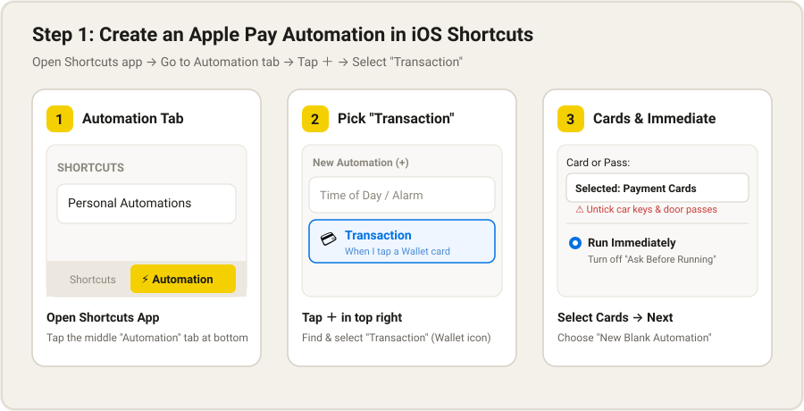
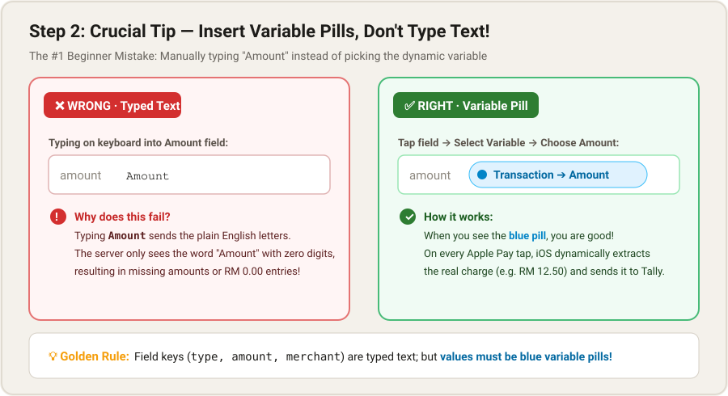
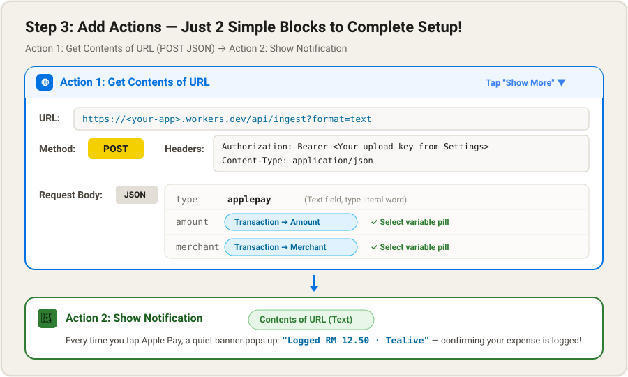

# Tally Cloud · iPhone Shortcuts Setup Guide

> **Effortless 3-Step Expense Capture**: Use iOS Shortcuts automation to automatically log your Apple Pay taps, Touch 'n Go notifications, or bank SMS messages directly into your private Tally ledger. No need to open the app — transactions are recorded in seconds with an instant confirmation banner.

---

## ⚡ Core 3-Step Setup (Apple Pay Example)

### Step 1: Create an Apple Pay Automation Trigger

1. Open the built-in **Shortcuts** app on your iPhone.
2. Tap the **Automation** tab in the bottom navigation bar.
3. Tap **＋** in the top right corner, then select **Transaction** (the credit card icon).
4. **Key Configuration**:
   - **Card or Pass**: Select your payment debit / credit cards. (⚠️ **Make sure to untick digital car keys and access passes**).
   - **Execution**: Choose **Run Immediately**. Turn off "Ask Before Running".
5. Tap **Next**, then choose **New Blank Automation**.

---

### Step 2: Crucial Rule — Insert Variable Pills, Don't Type Text!

This is the #1 beginner mistake when setting up Shortcuts:
* ❌ **WRONG**: Typing the letters `Amount` on your keyboard. The server receives the English word "Amount", not your transaction number!
* ✅ **RIGHT**: Tap the value field, tap the blue **Select Variable** bar above your keyboard, and choose **`Transaction ➔ Amount`**. Only values displayed in a **blue capsule pill** will dynamically read the real charge amount on each tap.

---

### Step 3: Add Actions (Only 2 Simple Blocks!)

In the automation editor, tap **Add Action** and add these two steps:

#### Action 1: Get Contents of URL
Search for **Get Contents of URL**, tap the blue arrow to expand its options:
* **URL**: Paste your ingest address (copy it with one click from Tally Settings):  
  `https://<your-subdomain>.workers.dev/api/ingest?format=text`
* **Method**: Change from `GET` to **`POST`**.
* **Headers**: Add two rows:
  * `Authorization`: `Bearer <Your_Upload_Key>` (generated in Tally Settings; keep a space after `Bearer`)
  * `Content-Type`: `application/json`
* **Request Body**: Choose **JSON**, then tap **Add new field** to add:
  * `type` (Text): Type `applepay`
  * `amount` (Variable): Select variable ➔ **`Transaction ➔ Amount`** (Blue Pill)
  * `merchant` (Variable): Select variable ➔ **`Transaction ➔ Merchant`** (Blue Pill)

#### Action 2: Show Notification
Search for and add **Show Notification**:
* Set the notification text to the **`Contents of URL`** variable.
* **Result**: Every time you tap to pay, your iPhone instantly displays a banner:  
  `Logged RM 12.50 · Tealive` — confirming your expense has been cleanly recorded!

---

## 📱 Other Automation Sources (Optional)

### 1. Touch 'n Go eWallet (TNG Notifications)
If your iOS version supports the **App / Notification** trigger:
* **Trigger**: Automation ➔ ＋ ➔ Choose **App / Notification** ➔ Select **Touch 'n Go eWallet**.
* **Action**: Add **Get Contents of URL** (POST) with JSON fields:
  * `type`: `notification`
  * `title`: Variable ➔ `Notification ➔ Title`
  * `body`: Variable ➔ `Notification ➔ Body`
* **Smart Filter**: Tally automatically extracts the merchant and amount from the text, while safely ignoring top-ups (Cash-In / GO+), promos, and refunds!

### 2. Custom Notifications & Bank SMS (AI Agent Setup)
Tally's `/api/ingest` endpoint accepts any standard JSON payload. If you want to capture specific bank charge SMS or other financial apps beyond Apple Pay and TNG:
Simply ask your AI agent (ChatGPT, Claude, etc.):
> *"I use Tally for expense tracking. Here is a bank transaction SMS/notification format: `<paste text>`. How should I configure my iPhone Shortcut to POST this to `/api/ingest`?"*

Your AI agent will give you the exact field mapping and regex trigger for your Shortcuts automation in seconds.

---

## 💡 Testing & Troubleshooting

| Symptom | Likely Cause | Quick Fix |
|---|---|---|
| Nothing happens after payment | Automation not enabled or not set to Run Immediately | Check Shortcuts Automation tab, ensure toggle is ON and set to Run Immediately. |
| Car key / door badge triggers an entry | Card or Pass set to "Any Card" | Edit automation, untick non-payment passes, keep only payment cards. |
| Amount logged as RM 0.00 | Typed literal word "Amount" | Delete the word in Shortcuts, tap field and pick the blue variable pill. |
| 401 Unauthorized | Missing or invalid Upload Key | Check `Authorization` header has `Bearer <Token>` with a space in between. |
| Notification shows a file name | Variable type mismatch | Tap `Contents of URL` inside Show Notification and set type to **Text**. |
